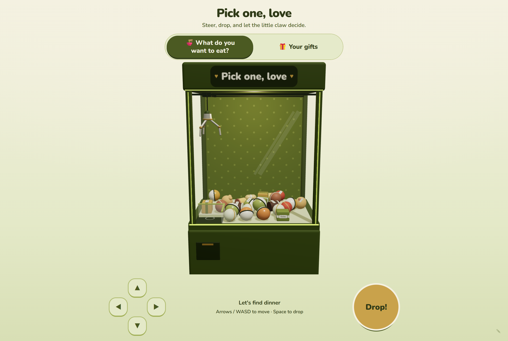
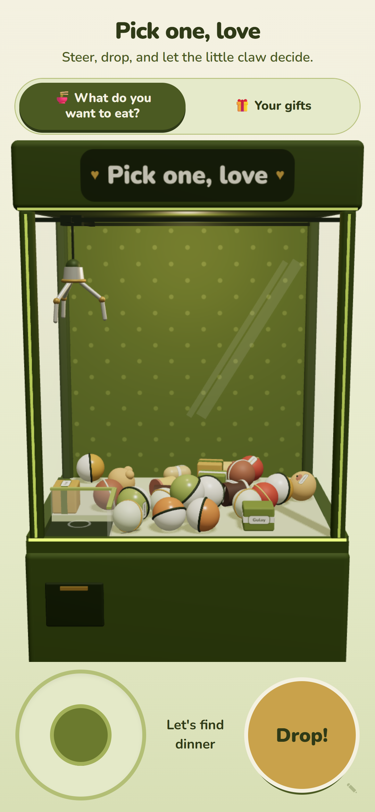

# claw-machine 💛

**Live demo: [claw-machine-nu.vercel.app](https://claw-machine-nu.vercel.app)** (edit PIN
`1234`; your edits stay in your own browser)

<p align="center">
  <a href="https://claw-machine-nu.vercel.app">
    
  </a>
  
</p>

A cozy 3D claw machine made as a gift. She steers the claw, drops it, and the prize
decides **where you eat tonight** or reveals **a gift you picked for her**. There are no
credits, no costs and no losing: the claw always comes through.

- **What do you want to eat?** She wins one place. The reveal card shows your note, an optional
  photo and a map link. The pick lasts for the day; at midnight she can pick again.
- **Your gifts.** She collects every gift eventually. Each one opens with your message and an
  optional redeem note, then waits in the gift box. By default **one gift unlocks per day**
  (like an advent calendar), and the last one plays a little celebration with your final
  message.

Built with Next.js 16 (App Router), TypeScript, Tailwind CSS v4, three.js, React Three
Fiber, drei, Rapier physics, zustand and zod.

## Run it

Requires Node 20.19 or newer.

```bash
npm install
npm run dev        # http://localhost:3000
```

| Script              | What it does                                   |
| ------------------- | ---------------------------------------------- |
| `npm run dev`       | Dev server with hot reload                     |
| `npm test`          | Vitest unit tests (game logic, stores, schema) |
| `npm run lint`      | ESLint (Next + Prettier rules)                 |
| `npm run typecheck` | TypeScript, no emit                            |
| `npm run format`    | Prettier, write                                |
| `npm run build`     | Production build                               |
| `npm start`         | Serve the production build                     |

**Controls:** arrow keys or WASD move the claw, Space drops. On a phone: the thumb stick and
the big **Drop!** button. The ring under the claw turns **gold** when a prize is in reach.

## Deploy to Vercel

The demo runs on Vercel at **https://claw-machine-nu.vercel.app**. The whole app is a static
build, so no environment variables are needed.

From the terminal, with the Vercel CLI logged in:

```bash
vercel deploy --prod   # build on Vercel and update the production URL
vercel deploy          # preview deployment
```

Or connect a Git repo: push this folder to GitHub, choose **Add New → Project** in Vercel,
import it and keep the detected Next.js settings. Every push to `main` then redeploys.

Send her the production URL; on iPhone, _Share → Add to Home Screen_ makes it feel like an
app. Per-deployment URLs (`claw-machine-<hash>-….vercel.app`) sit behind Vercel's deployment
protection, so always share the production one.

## Make it yours: editing prizes

Open the editor with **Shift + E**, or tap the faint ✎ in the bottom-right corner, then enter
the PIN. **The default PIN is `1234`; change it under Machine → Edit PIN.** The PIN only stops
accidental taps; it is not security.

- **Prizes tab:** pick _Dinner_ or _Gifts_, then add, duplicate, reorder or delete prizes. Tap
  a prize in the list, or tap it inside the machine, to edit its name, label (14 characters),
  shape, size, colors, glow, weight, slipperiness, how many copies spawn, the reveal title,
  your note, the redeem note, a link and a photo. Changing a prize respawns only that prize.
- **Machine tab:** title and subtitle, the final message, gifts per day (0 = no limit), claw
  strength and speed, after how many misses a grab is guaranteed, cabinet size, gravity, the
  shuffle seed and the PIN.
- **Data tab:** respawn everything, export or import JSON (imports are validated and every
  problem is listed), reset her progress, or reset to the defaults.

Edits save in **this browser's localStorage**. Your phone and hers don't share storage, so to
put your prizes on her phone, ship them with the app:

1. Edit everything on your own device, then **Data → Export JSON**. Exporting bumps the config
   `revision`.
2. Replace `src/config/default-config.json` with the exported file.
3. Run `npm test`. A test validates that file and lists anything wrong.
4. Deploy. On her next visit, the newer revision replaces whatever her browser had saved.
   Her collected gifts are kept.

Alternatively, use **Import JSON** on her phone directly.

Photos are shrunk to 640px JPEGs before saving. localStorage holds about 5 MB, so a handful of
photos is fine; if storage fills up, the editor shows a warning. Image links (`https://…`) take
no storage at all.

**Everything you ship is public.** The app has no server, so `default-config.json` (every note,
redeem note, the final message, any embedded photos and the PIN) is bundled into the
JavaScript that every visitor downloads. The one-gift-a-day lock also runs only in the browser.
Anyone with the link can read every gift early in DevTools, so keep anything truly private out
of the shipped config. The page asks search engines not to index it (`robots` in
`src/app/layout.tsx`), but that only keeps it out of search results; the link itself still
works for anyone who has it.

## How "she always wins" works

Every grab rolls a seeded random number against a grip chance:

```
base   = clamp(strength − 0.15 × (weight − 1) − 0.4 × slipperiness, 0.05, 1)
chance = base + (1 − base) × min(1, misses / pityThreshold)
```

Each miss (a slip or an empty grab) closes an equal slice of the gap, so after
`pityThreshold` misses (default 3) the next grab always holds. Misses also widen how far the
claw reaches for a prize, up to 2.5× at the threshold, so near misses still catch something.
Slips look real: the prize rides up a little and wiggles free, with a gentle "So close, try
again". There is never a "you lose".

## Architecture

```
 src/app (server)            src/components (client only, loaded with ssr: false)
 ┌───────────────┐           ┌───────────────────────────────────────────────────────┐
 │ layout, page  │──────────▶│ ClawMachineApp                                        │
 └───────────────┘           │  ├─ play/  Header, ModeTabs, Controls, RevealCard,    │
                             │  │         GiftShelf, Celebration, PinDialog …       │
                             │  ├─ edit/  EditPanel → PrizeListEditor, PrizeEditor,  │
                             │  │         MachineSettings, DataTools                 │
                             │  └─ scene/ MachineCanvas (R3F + Rapier)               │
                             │            CabinetShell · CabinetColliders · Prizes   │
                             │            Claw (useFrame + refs, no per-frame store) │
                             └──────────────┬───────────────────────▲────────────────┘
                     discrete transitions    │                       │ selectors
                     (DROP, GRIP_CLOSED, …)  ▼                       │
                             ┌───────────────────────────────────────┴───────────────┐
                             │ src/stores (zustand + persist → localStorage)          │
                             │  useMachineStore: config (prizes, theme, settings)     │
                             │  useGameStore: mode, claw state, pity, wins, days      │
                             └──────────────┬─────────────────────────────────────────┘
                                            │ calls pure functions
                             ┌──────────────▼─────────────────────────────────────────┐
                             │ src/game (no React, no three)                          │
                             │  clawMachine  state machine: idle → moving → descending│
                             │               → gripping → ascending → returning →    │
                             │               releasing → idle                         │
                             │  clawMotion   per-frame kinematics   grip   pity math  │
                             │  rng (mulberry32)  spawn  layout  pick  daily  schema  │
                             └────────────────────────────────────────────────────────┘
 src/lib     helpers (controls, camera fit, contrast, storage, textures, sound stub …)
 src/config  constants, theme palette, copy, default-config.json
 src/hooks   useKeyboardControls, useDailyRhythm, useToday, usePrefersReducedMotion …
```

- Everything in `src/game` is pure and unit-tested; the scene only reads state and drives
  physics.
- The claw moves through refs inside `useFrame`; only phase transitions go to the store.
- Prizes are Rapier rigid bodies, capped at 40. The claw locks onto the prize it is going for
  so its prongs can't shove it away; neighbors still get nudged.
- The colors live in `src/config/theme.ts` (three.js) and `globals.css` (Tailwind). A test keeps
  them in sync and checks that every text and background pair meets WCAG AA contrast.
- `playSound(name)` in `src/lib/sound.ts` is a stub. Plug in audio with `setSoundHandler`.
- `prefers-reduced-motion` turns off the glow pulsing, confetti and pop animations.

## Next ideas

- **Custom GLB models:** load small `.glb` prizes with drei's `useGLTF` and keep a simple
  collider from `prizeCollider`.
- **Photo prizes:** put her photos on capsule prizes as textures.
- **Shareable link:** compress the config (for example with `CompressionStream`) into the URL
  hash, so "send her the link" also sends the prizes.
- **Background music:** a soft loop plus `setSoundHandler` for clicks, grabs and the win jingle.
- **Synced progress:** store progress in a tiny backend so it follows her across devices.
